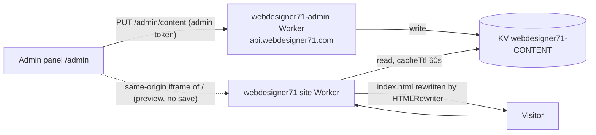

# WebDesigner71 CMS — Phase 1 Design

Status: design only, not implemented. Last updated 2026-11-01.

## Scope
Editable from webdesigner71.com/admin (admin only):
- Homepage headline `<h1 id="hero-title">` — plain text + optional gold highlight (`<em>`).
- Hero sub line `section.hero p.sub` (gets `id="hero-sub"`).
- Accent color CSS variable `--gold`.

New in this revision:
- **Live preview** of the real homepage while editing, before saving.
- **Modal edit forms** (popup dialogs with fields, Save / Cancel) in the admin panel.

## 1. Architecture



- New KV namespace `webdesigner71-CONTENT`, bound as `CONTENT` in both Workers (separate from `USERS`).
- `webdesigner71-admin` writes (admin only); public read via `GET /content`.
- `webdesigner71` site Worker gets a small script: for `/` and `/index.html` it rewrites the page from KV with HTMLRewriter; everything else is served from assets untouched. Missing key or KV error → original `index.html` (fail-safe).
- Saves appear worldwide within ~60 s; no redeploy.
- **Preview needs no server work**: `/admin` and `/` are on the same origin, so the panel loads the real homepage in an iframe and edits its DOM directly. Nothing is saved until Save.

## 2. KV keys

`content:homepage` (live) and `content:homepage:prev` (one-step undo), same shape:

```json
{
  "heroTitle": "আপনার ব্যবসার ওয়েবসাইট, মাত্র",
  "heroHighlight": "৩৯০০ টাকায়",
  "heroSub": "ডোমেইন, হোস্টিং, ডিজাইন — সব এক প্যাকেজে",
  "accentColor": "#D4A017",
  "updatedAt": "2026-11-01T16:30:00.000Z",
  "updatedBy": "sohelhoo@gmail.com",
  "version": 3
}
```

Validation (server and client): `heroTitle` 1–120 chars; `heroHighlight` 0–40; `heroSub` 0–300; `accentColor` `^#[0-9A-Fa-f]{6}$`. Plain text only, never HTML.

## 3. API (admin-worker/src/index.js)

| Method & path | Auth | Response |
|---|---|---|
| `GET /content` | public | `200 {"content":{...}}` or `{"content":null}` |
| `PUT /admin/content` | admin session | `200 {"ok":true,"content":{...,"version":4}}` · `400 {"error":"invalid_field","field":"accentColor"}` · `403 admin_only` · `409 version_conflict` |
| `POST /admin/content/undo` | admin session | `200 {"ok":true,"content":{...}}` · `404` if no previous |

`PUT` body: `{"heroTitle":"…","heroHighlight":"…","heroSub":"…","accentColor":"#0B7A55","version":3}`. `version` must equal the stored version (stops two tabs overwriting each other). Old value is copied to `content:homepage:prev` first. Add `PUT` to CORS allowed methods. Routes go after the `/admin/users` block, reusing `requireSession` + `isAdmin`.

## 4. Admin panel UI (admin/index.html)

### 4.1 Content card (dashboard, admin only)
Shows current headline, sub line, and a color swatch, with **"এডিট করুন"** (opens the modal) and **"আগের ভার্সনে ফিরুন"** (undo, via confirm modal). Footer: "সর্বশেষ আপডেট: <time> · <email>".

### 4.2 Modal system (reusable)
- Built on native `<dialog>` + `showModal()`: built-in focus trap, Esc to close, `::backdrop`. No library.
- Look: matches the site palette (`--green`, `--gold`, `--cream`), 18px radius, soft shadow, backdrop `rgba(11,61,46,.45)` + `backdrop-filter: blur(4px)`, open animation (fade + scale .96→1, 160 ms; respects `prefers-reduced-motion`).
- Structure: header (title + ✕), scrollable body, sticky footer with **বাতিল** (secondary) and **সেভ করুন** (primary, gold).
- Fields: floating labels, character counters (`৮৫/১২০`), inline Bengali error text under the field, red outline on invalid.
- Save button: disabled until something changed and all fields valid; shows spinner while saving; on success closes and shows a toast "সেভ হয়েছে — ১ মিনিটের মধ্যে লাইভ হবে".
- Cancel / ✕ / Esc / backdrop click: if there are unsaved changes, ask "পরিবর্তন বাদ দেবেন?" (small confirm modal); otherwise close.
- Errors: 400 → highlight that field; 409 → banner "অন্য কোথাও এডিট হয়েছে, নতুন ডেটা লোড করুন" with a Reload button; network error → keep modal open, show retry.
- Helper API: `openModal({title, fields, values, onSave, preview})`, `confirmModal({title, message, danger})`. Reused later for Phase 2 sections, and to replace the current approve/reject/delete user prompts.
- Mobile (<720px): modal becomes a full-height bottom sheet.

### 4.3 Content modal = form + live preview
- Desktop: two columns (form ~360px left, preview right), modal width `min(1200px, 96vw)`.
- Mobile: tabs **ফর্ম | প্রিভিউ** at the top of the sheet.
- Fields: শিরোনাম (`heroTitle`), হাইলাইট অংশ (`heroHighlight`), সাব-টেক্সট (textarea, `heroSub`), অ্যাকসেন্ট রং (`<input type="color">` + hex box + 6 preset swatches incl. the original `#D4A017` "ডিফল্ট").

## 5. Live preview

- Preview pane: `<iframe id="pv" src="/?cms_preview=1" sandbox="allow-same-origin allow-scripts">` — the real live homepage, same origin.
- On iframe `load`, the panel grabs `pv.contentDocument` and applies the current form values; on every `input` event (debounced ~50 ms) it re-applies:
  - `#hero-title` → `textContent = heroTitle + " "` then append `<em>` with `heroHighlight` (built with DOM APIs, never innerHTML).
  - `#hero-sub` (fallback `.hero .sub`) → `textContent`.
  - `--gold` → `doc.documentElement.style.setProperty('--gold', color)`; also `--gold-2` set to a 10% lighter shade so hover states match.
  - Scrolls the hero into view and briefly outlines the element being edited (2 px dashed gold, removed after 1 s).
- Toolbar above the preview: **ডেস্কটপ / মোবাইল** toggle (iframe width 100% vs 390 px, scaled to fit with CSS `transform: scale()`), **রিসেট** (back to saved values), and a "প্রিভিউ — এখনো সেভ হয়নি" badge.
- Cancel discards: nothing was written anywhere; the iframe is just closed.
- `?cms_preview=1`: the site Worker skips KV rewriting for this param, so the preview always starts from the clean template, and adds `<meta name="robots" content="noindex">` + `Cache-Control: no-store`. Also hides nothing else; the page is otherwise identical.
- The preview code uses the same field→element mapping as the site Worker's HTMLRewriter, kept in one small shared object `CMS_TARGETS` in both files, so preview and live always match.
- If the iframe can't be read (e.g. a future cross-origin move), the pane shows a static mock hero rendered with the same CSS variables instead.

## 6. Site Worker (new `site-worker/src/index.js`, ~50 lines)
- `/` or `/index.html`: fetch from `env.ASSETS`; unless `cms_preview=1`, read `env.CONTENT.get("content:homepage",{type:"json",cacheTtl:60})` and rewrite `#hero-title`, `#hero-sub`, and append `<style id="wd71-cms">:root{--gold:…;--gold-2:…}</style>` before `</head>`.
- All other paths: `env.ASSETS.fetch(request)`.

Site `wrangler.jsonc`:
```jsonc
{
  "name": "webdesigner71",
  "main": "site-worker/src/index.js",
  "compatibility_date": "2026-10-23",
  "assets": { "directory": "./public", "binding": "ASSETS", "run_worker_first": ["/", "/index.html"] },
  "kv_namespaces": [{ "binding": "CONTENT", "id": "<CONTENT namespace id>" }],
  "observability": { "enabled": true }
}
```
Site files move into `public/` (stops `wrangler.jsonc`, `.gitignore`, `admin-worker/`, `docs/` being publicly served).

## 7. Build order
1. Create KV `webdesigner71-CONTENT`.
2. Admin Worker: `CONTENT` binding, `GET /content`, `PUT /admin/content`, undo, validation, PUT in CORS; e2e tests (admin save, non-admin 403, bad color 400, stale version 409, undo).
3. Deploy admin Worker; seed `content:homepage` with today's live values.
4. Repo: move site into `public/`, add `id="hero-sub"`, add `site-worker/` and new `wrangler.jsonc`.
5. `wrangler dev`: page identical with seed; KV change shows; deleted key falls back; `?cms_preview=1` ignores KV; `/admin/`, `/old-homepage/` unaffected.
6. Deploy site Worker (note previous version id for rollback); verify `/` identical, `/wrangler.jsonc` 404.
7. Admin panel: modal system → Content card → content modal → live preview (desktop + mobile).
8. Test end to end: edit in modal, watch preview, Cancel (nothing saved), Save (live within 60 s), Undo.
9. Push to GitHub; user runs `git pull` before any redeploy from Cursor.

## Phase 2 (later)
More fields in the same key (`<title>`, prices, section texts, second color), image upload to R2, edit history beyond one undo.
