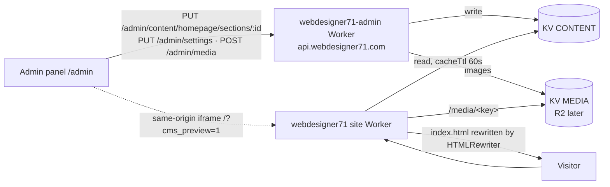

# WebDesigner71 CMS — Phase 2

Status: implemented. Last updated 2026-11-01. Builds on [Phase 1](cms-phase1.md): same Google login, approval flow, session, modal system and live preview.

## Scope
Editable from webdesigner71.com/admin (admin only):
- **Every homepage section**: header & menu, hero, problem/solution, packages, work samples, how-we-work, FAQ, call-to-action, footer.
  - Text, images, buttons and links; show/hide the whole section.
  - Repeated items (buttons, menu links, cards, FAQ, list points) can be added, removed, hidden and reordered.
  - New elements at the end of a section: **heading, paragraph, image, button**.
  - The hero highlight (`<em>` gold part of the headline) is kept as its own field.
- **Settings**: site title, meta description, accent colour, primary colour, footer contact (phone, email, address).
- **Media**: image library (upload, alt text, copy URL, delete), used by every image field.

Not in scope: e-commerce, creating Pages or Posts (sidebar shows "শীঘ্রই আসছে").

## 1. Architecture



- **One shared model**: `public/cms/model.js` (byte-identical copy in `admin-worker/src/cms-model.js`). It holds the schema, defaults (= today's page), validation (`cleanSection`, `cleanSettings`), URL rules and `plan(doc, settings)`, which turns content into DOM edits. The site Worker (HTMLRewriter), the admin API (validation) and the admin live preview (DOM) all use it, so preview and live always match.
- Every editable element in `public/index.html` carries `data-cms="<section>.<field>"`; sections carry `data-cms-section`, and the place where extra elements go carries `data-cms-slot`.
- Fields equal to the default produce no edit, so the seed renders the original page (plus the `<style id="wd71-cms">` tag and the `data-cms` attributes).
- **Fail-safe**: missing content, invalid data or any KV/plan error → the original `index.html`, byte-identical.

## 2. KV keys (CONTENT)

| Key | Contents |
|---|---|
| `content:homepage:v2` | `{schema:2, sections:[…], updatedAt}` — all sections |
| `content:homepage:v2:prev:<id>` | previous version of one section (one-step undo per section) |
| `settings:site` | settings object |
| `settings:site:prev` | previous settings (undo) |
| `content:homepage` | Phase 1 key — read only as a migration fallback, never written |

**Migration**: if `content:homepage:v2` is missing but the Phase 1 key exists, the site Worker renders it through `migrateV1` (hero title/highlight/sub + accent colour), so what is live does not change. The first section save writes the v2 document.

A section (hero, abbreviated):

```json
{
  "id": "hero", "hidden": false, "version": 3,
  "updatedAt": "2026-11-01T18:00:00.000Z", "updatedBy": "sohelhoo@gmail.com",
  "fields": {
    "badge":   { "text": "ফ্রি ডোমেইন ও হোস্টিং", "hidden": false },
    "title":   { "text": "উদ্যোক্তাদের জন্য ওয়েবসাইট ডিজাইন", "highlight": "সম্পূর্ণ ফ্রি।" },
    "sub":     { "text": "ডোমেইন, হোস্টিং, ডিজাইন — সব এক প্যাকেজে", "hidden": false },
    "buttons": { "items": [ { "id": "b1", "label": "অফার নিন →", "href": "#packages", "style": "gold", "newTab": false, "hidden": false } ] },
    "trust":   { "items": [ { "id": "t1", "text": "ই-কমার্স ও বিজনেস ওয়েবসাইট", "hidden": false } ] },
    "image":   { "src": "", "alt": "", "hidden": false }
  },
  "extra": [
    { "id": "x1", "type": "heading", "text": "…", "hidden": false },
    { "id": "x2", "type": "text",    "text": "…", "hidden": false },
    { "id": "x3", "type": "image",   "src": "/media/2026-11-AbC.png", "alt": "…", "hidden": false },
    { "id": "x4", "type": "button",  "label": "…", "href": "#contact", "style": "gold", "newTab": false, "hidden": false }
  ]
}
```

`image.src` empty = the original illustration. Extra elements exist for sections with a slot (all but header and footer).

Settings: `{siteTitle 1–120, metaDescription 0–300, accentColor #RRGGBB, primaryColor #RRGGBB, contactPhone, contactEmail, contactAddress ≤160, version, updatedAt, updatedBy}`.

### Element types and rules
- Field kinds: `text` (headings allow `[[gold part]]`), `heroTitle` (text + highlight → `<em>`), `link`, `buttons` (repeater; style gold/green/ghost/outline; new tab), `image` (src + alt), `links` (menu), `list`, `cards` (problem / package / work / step / FAQ). Optional fields and every repeated item can be hidden.
- **Text** is plain text, always escaped on output (FAQ answers allow `**bold**`, rendered as `<strong>`).
- **Links**: only `http(s)://`, `mailto:`, `tel:`, `#anchor` or relative paths (`safeHref`).
- **Images**: only `/media/<key>` or `/assets/<file>` (`safeImg`).
- Limits per field (length, item counts) are in `SECTIONS` in the model; the server re-checks everything.

## 3. API (admin-worker/src/index.js)

All writes need an **admin** session (`403 admin_only` otherwise). Errors: `400 {"error":"invalid_field","field":"title.text"}` (the panel highlights that field), `409 version_conflict` (with the current data), `413 too_large`. CORS allows `GET, POST, PUT, DELETE, OPTIONS`.

| Method & path | Auth | Response |
|---|---|---|
| `GET /content/homepage` | public | `200 {"schema":2,"source":"v2"\|"v1"\|"defaults","sections":[…],"settings":{…}}` |
| `PUT /admin/content/homepage/sections/:id` | admin | body `{hidden, fields, extra, version}` → `200 {"ok":true,"section":{…,"version":n+1}}` |
| `POST /admin/content/homepage/sections/:id/undo` | admin | `200 {"ok":true,"section":{…}}` · `404 no_previous` |
| `GET /admin/settings` | session | `200 {"settings":{…}}` |
| `PUT /admin/settings` | admin | body = settings + `version` → `200 {"ok":true,"settings":{…}}` |
| `POST /admin/settings/undo` | admin | `200 {"ok":true,"settings":{…}}` · `404 no_previous` |
| `GET /admin/media` | session | `200 {"storage":"kv","maxBytes":5242880,"types":[…],"items":[…],"builtin":[…]}` |
| `POST /admin/media` | admin | multipart `file` (+ `alt`) → `201 {"ok":true,"item":{…}}` · `413` · `415 unsupported_type` |
| `PUT /admin/media/:key` | admin | `{"alt":"…"}` → `200 {"ok":true,"item":{…}}` |
| `DELETE /admin/media/:key` | admin | `200 {"ok":true,"deleted":key}` · `409 {"error":"in_use","usedIn":[…]}` unless `?force=1` |
| `PUT /admin/content`, `POST /admin/content/undo` | — | **`410 {"error":"superseded","use":"…"}`** (Phase 1 writes) |
| `GET /content` | public | Phase 1 read shape, derived from v2 (kept for compatibility) |

- `version` must equal the stored version (defaults count as version 0). Before each write the old section/settings are copied to the `:prev` key, so undo is one step per section.
- Media item: `{key, url:"/media/<key>", contentType, size, alt, name, uploadedAt, uploadedBy, usedIn:["hero.image.src","hero.extra.x3.src",…]}`.

## 4. Media

- **Storage: Workers KV fallback** — R2 is not enabled on the Cloudflare account (API error 10042), so the `MEDIA` binding is the KV namespace `webdesigner71-media` (id `51450a6f…`). Value = image bytes; metadata = `{contentType, size, alt, name, uploadedAt, uploadedBy}`. Key `YYYY-MM-<random>.<ext>`.
- **To switch to R2**: enable R2 in the Cloudflare dashboard, create bucket `webdesigner71-media`, and in both `wrangler.jsonc` files replace the KV `MEDIA` entry with `"r2_buckets": [{ "binding": "MEDIA", "bucket_name": "webdesigner71-media" }]`. The code detects R2 by the binding's API; no code change. Existing KV images would need copying over (none in production now).
- Accepted: JPEG, PNG, WebP, GIF only — checked by **file signature** (magic bytes), not the file name or browser type. **SVG is refused.** Max **5 MB** (client and server).
- Served by the site Worker at `https://webdesigner71.com/media/<key>`: `Cache-Control: public, max-age=31536000, immutable`, `ETag` / `304`, `X-Content-Type-Options: nosniff`, `Content-Security-Policy: default-src 'none'; sandbox`. Unknown key → 404.
- The library also lists the site's own illustrations (`/assets/…`, read only) and shows where each image is used ("ব্যবহৃত: হিরো"). Deleting an image still in use offers "সেকশনে যান" instead.

## 5. Admin panel UI (public/admin/index.html)

### 5.1 Layout
- Top bar + **left sidebar** (green `#0B3D2E`, gold active item, cream content area, Bengali UI). Under 900 px the sidebar becomes a **drawer**: ☰ button, overlay, ✕, Esc and tapping a link close it.
- Hash router (`#/dashboard`, `#/homepage/hero`, `#/media` …), so browser back/forward works.
- Login, approval and session are unchanged from Phase 1; non-admin approved users still see only their own status.

| Sidebar item | Page |
|---|---|
| ড্যাশবোর্ড | last update (time, who, which section), pending users count, media count, quick links, recent changes per section |
| হোমপেজ | list of sections (show/hide state, last update) + one sub-item per section → section page (field summary, edit, undo) |
| পেজ / পোস্ট | placeholder "শীঘ্রই আসছে" |
| মিডিয়া | library grid: upload (button or drag & drop), alt text, copy URL, delete (confirm modal), usage badges |
| ইউজার | the existing approval list (approve / reject / delete), pending badge |
| সেটিংস | site title, meta description, accent + primary colour, footer phone / email / address; edit modal with preview; undo |

### 5.2 Section editor
- Reuses the Phase 1 modal: form left, **live preview** right (`/?cms_preview=1` iframe), desktop/mobile toggle, reset, mobile tabs ফর্ম | প্রিভিউ.
- Section show/hide toggle; per-field hide; repeaters with ↑ ↓ (reorder), 👁 (hide), 🗑 (remove), "+ যোগ করুন".
- "নতুন এলিমেন্ট" adders: শিরোনাম, প্যারাগ্রাফ, ছবি, বাটন (appended at the section's slot).
- Image fields open the **media picker** (library + built-in, with upload inside the picker).
- Same behaviour as Phase 1: Save disabled until dirty and valid; inline Bengali errors; dirty-close confirm; `400` → field highlighted; `409` → banner with রিলোড; network error → retry, edits kept; success toast "সেভ হয়েছে — ১ মিনিটের মধ্যে লাইভ হবে"; per-section undo.
- Clicking a field on the section page opens the editor scrolled to that field and outlines it in the preview.

## 6. Public rendering (site-worker/src/index.js)
- `/`, `/index.html`: read `content:homepage:v2` + `settings:site` (cacheTtl 60 s), fall back to the Phase 1 key via `migrateV1`; run `plan()` → HTMLRewriter edits on `[data-cms]` elements; add `<style id="wd71-cms">` (colours) before `</head>`; title / meta description / theme-color only when changed.
- Hidden section/field/item → element removed. Extras → appended inside `[data-cms-slot]`. Contact settings → `<p class="cms-contact">` in the footer slot.
- All text escaped; links and image URLs re-checked with `safeHref` / `safeImg` at render time.
- Any error → original `index.html` untouched. `?cms_preview=1` → no KV, `noindex`, `no-store` (the panel applies the same plan in the iframe DOM).
- `run_worker_first`: `/`, `/index.html`, `/media/*`. Everything else (incl. `/admin/`, `/old-homepage/`) is plain assets; repo files (`wrangler.jsonc`, `docs/` …) are not in `public/` and return 404.

## 7. Tests
- `admin-worker/test/e2e.mjs` (wrangler dev, real Workers runtime): auth, approvals, section PUT/validation/409/undo, settings, media upload / signature check / svg + oversize refusal / alt / usage / in-use delete / force delete, 410 for Phase 1 writes, CORS.
- `site-worker/test/check.mjs`: seed = original page + style tag only, Phase 1 key migration, every field kind, hide/reorder/extras, escaping, settings, fail-safe on bad data, `/media` headers / ETag / HEAD.
- `site-worker/test/admin-ui.mjs` — headless UI test (Playwright, mocked API, no production writes; 144 checks): sidebar navigation, every section editor with live preview, buttons add/remove/reorder/hide, extra elements, media picker, validation, 409 banner, media upload / alt / copy / delete, svg + oversize rejection, settings save + undo, mobile drawer at 390 px, preview text = public page.

## 8. Deploy / rollback
1. Note the current version ids: `wrangler versions list` (site: `webdesigner71`, admin: `webdesigner71-admin`).
2. Deploy admin Worker first (`admin-worker/`), then the site (`wrangler deploy` in the repo root).
3. Seed: `content:homepage:v2` = `seedDoc()`, `settings:site` = `DEFAULT_SETTINGS` (identical to what was live).
4. Check both `webdesigner71.com` and `www.` equal the pre-deploy page except `data-cms` attributes and the style tag.
5. Rollback: `wrangler rollback <version-id>` for each Worker. Content keys can stay; the old site Worker ignores v2 keys.
