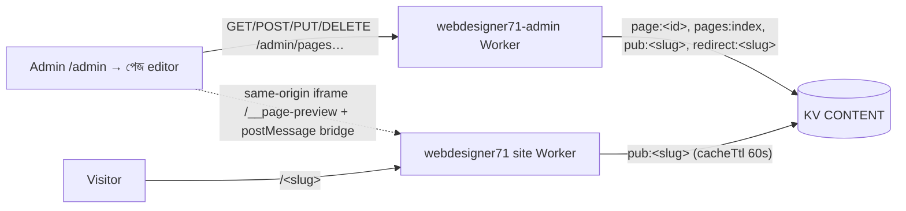

# WebDesigner71 CMS — Phase 3: Pages (visual page builder)

Status: implemented. Last updated 2026-11-02. Builds on [Phase 1](cms-phase1.md) and [Phase 2](cms-phase2.md). It uses the same Google login, admin approval, session, modals, media library and settings. Phase 2 (homepage editing) is unchanged, and the homepage HTML stays byte-identical (tested).

## Scope
- **Admin → পেজ**:
  - list, create (blank / about / services / contact templates), edit, delete, publish, unpublish, duplicate
  - SEO dialog: title, description, share image, noindex, slug
- **Full-screen Bengali editor**:
  - left: Blocks library / Patterns / Layers (tree with drag-and-drop)
  - centre: live iframe preview with a desktop / tablet / mobile toggle
  - right: inspector with **Content / Style / Advanced** tabs
  - undo/redo, local autosave + restore, save draft, publish, 409 conflict handling, unsaved-changes warning, keyboard shortcuts
- **Public rendering**:
  - published pages at `webdesigner71.com/<slug>` (and www) inside the site's own header, footer, fonts and CMS colours
  - `301` redirects from old slugs, a styled 404, and `/sitemap.xml`

Not in scope: e-commerce, Posts, custom code/HTML blocks, global reusable blocks, scheduled publishing, revision history beyond one step back.

## 1. Research: what we took and what we left out
| Product | Good | Problem for our users | What we did |
|---|---|---|---|
| **Shopify** (Online Store 2.0 theme editor) | Section + block model; sidebar tree; very safe (theme decides the design) | Little visual freedom; settings are spread across theme files | Kept the **section → block tree** and safe, schema-validated settings |
| **WordPress Gutenberg** | Block grammar, patterns, List View, keyboard-first, undo | Inline toolbars and nested selection confuse beginners; per-device styling is weak | **Patterns**, a **Layers** list view, shortcuts. Editing happens in one stable inspector, not floating toolbars |
| **Elementor** | Content / Style / Advanced tabs; per-device values; copy/paste style | Very many controls; heavy CSS/JS output; easy to break a layout | Took the **3 tabs, per-device values, copy/paste style**. Controls are grouped and folded, with whitelisted values only, and the output is small static HTML + one `<style>` |
| **Wix** | Truly free drag anywhere; huge template library | Absolute positioning breaks on mobile; separate mobile editor drifts out of sync | **No absolute positioning**: everything flows, so mobile always works. A mobile value **overrides** the desktop one instead of forking the page |
| **Squarespace** (Fluid Engine) | Beautiful defaults; section-based; design consistency | Grid editing is fiddly; limited control on small screens | **Good defaults from the site's design** (theme colours, fonts and shadows as swatches/presets), section layouts that look right without tuning |

Result: it is easier than Elementor and Wix, safer than Wix, and more visual than Shopify. It offers more per-device control than Gutenberg and Squarespace, and Elementor-level styling without its output weight. The editor UI is fully Bengali, and it works on a phone (single-pane mode with a bottom bar: ব্লক যোগ / ক্যানভাস / এডিট).

## 2. Architecture

- **One renderer.** `public/cms/pages.js` (byte-identical copy in `admin-worker/src/cms-pages.js`, tested) is shared by:
  - the admin Worker, for validation
  - the site Worker, for public HTML
  - the editor preview, through `public/cms/page-bridge.js`

  Preview and live output therefore cannot drift.
- **Preview**:
  - `/__page-preview` is an empty site shell (noindex, `no-store`, `frame-ancestors 'self'`).
  - The admin sends the draft over `postMessage`, and the bridge renders it with the same `renderPage`.
  - Messages: `pb:ready`, `pb:render`, `pb:select`, `pb:drop`, `pb:drag`, `pb:scroll`, `pb:key`. Origins are checked on both sides.
  - Drafts never touch the public site.
- **No shadowing**:
  - Static files are served first (`assets.run_worker_first` only for `/`, `/index.html` and `/media/*`), so `/admin/`, `/old-homepage/`, `/cms/` and `/assets/` always win.
  - The site Worker only sees a path when no file matches.
  - Reserved slugs (`admin`, `assets`, `cms`, `old-homepage`, `media`, `api`, `index`, `sitemap`, …) are rejected on create/save, and the site Worker refuses them as well.

## 3. Data model (KV `CONTENT`)
| Key | Value |
|---|---|
| `page:<id>` | Draft/working doc: `{schema:1, id, title, slug, seo:{title,description,image,noindex}, blocks:[…], status:"draft"\|"published", version, createdAt, updatedAt, updatedBy, publishedAt, publishedVersion, publishedSlug, redirects:[slug…]}` |
| `page:<id>:prev` | The previous editable state (one-step server undo) |
| `pages:index` | `[{id, title, slug, status, updatedAt, publishedAt, blocks, noindex, …}]`, used by the list and the sitemap |
| `pub:<slug>` | Published snapshot `{schema, id, slug, title, seo, blocks, version, publishedAt}`, the **only** thing the public site reads |
| `redirect:<slug>` | `{to, page}`: an old slug of a published page, served as a 301 (max 10 per page) |

- Ids: page `p` + 10 chars, block `b` + 8 chars.
- Slug: `^[a-z0-9]+(-[a-z0-9]+)*$`, max 60 characters.
- Limits:
  - 200 blocks, 256 KB per page, 100 pages
  - 24 items per repeater, 30×8 table, nesting depth 3
- **Block** = `{id, type, content:{…}, style:{…, t:{…}, m:{…}}, adv:{anchor, cls, hide:{d,t,m}}, children?:[…]}`.
  - `style` holds desktop values.
  - `style.t` / `style.m` override them on tablet (≤1024px) and mobile (≤767px).

### Blocks (17 + column)
- **Layout**: section (container with background), columns (2–4, with stacking on mobile) → column, spacer, divider
- **Basic**: breadcrumb, heading (H1–H6), paragraph (bold/italic/links, sanitised), buttons, list (tick/number/bullet), table, quote
- **Media**: image (media library, link, caption), video (YouTube/Vimeo in privacy mode)
- **Sections**: hero, card grid (icon/image cards), testimonial, FAQ (accordion), call-to-action, contact info

**Patterns**: page header, hero banner, feature cards, image + text, stats, services & pricing, testimonials, FAQ, CTA, contact.

**Templates**: blank, about, services, contact.

### Style controls (whitelisted, per element)
- **Typography**: colour, font (site font + 7 Google fonts), size\*, weight, line height, letter spacing, alignment\*
- **Background**: none / colour / gradient (2 colours + angle) / image (size, position, overlay colour + strength)
- **Spacing**: padding\* and margin\* per side, linked or unlinked
- **Border & shadow**: width, style, colour, radius, shadow preset
- **Size**: width %\*, max width\*, min height\*, box alignment\*
- **Advanced**: anchor id, up to 3 custom classes (`pb-`/`b-`/`wd71-` prefixes are blocked), hide on desktop/tablet/mobile

\* = can differ per device.

- Colours are theme swatches (primary, accent, ink, muted, cream, white, black) or `#RRGGBB` only.
- Fonts and shadows are presets, and numbers are clamped to their range.
- No free-form CSS is ever stored or rendered.

## 4. Renderer rules (security)
- All text is HTML-escaped. Rich text passes an allow-list sanitiser: `p br strong em a ul ol li`, with `script/style/iframe/svg/form…` dropped together with their content.
- URLs:
  - `safeHref` allows `/path`, `#anchor`, `https:`, `http:`, `mailto:` and `tel:`, and rejects `javascript:`, `data:` and protocol-relative URLs.
  - Images must be `/media/<key>` or `https:`.
  - Video only allows YouTube/Vimeo ids and renders `youtube-nocookie` / `player.vimeo.com`.
- CSS is generated only from whitelisted props, keyed by `.b-<id>`. Device overrides use `@media (max-width:1024px)` / `(max-width:767px)`, and "hide" uses exact device ranges.
- Non-full-width blocks are wrapped in `.pb-flow > .pb-in` (site content width), while sections/heroes/CTAs span full width.
- Page output: `<main class="pb-page">` inside the site's own `index.html`, using HTMLRewriter for the title, description, OG tags, canonical (apex domain) and `robots noindex` when asked. Header/footer CMS edits from Phase 2 apply, and `#anchors` in the header/footer are rewritten to `/#anchor`.
- Failure behaviour:
  - A KV error gives the original asset 404.
  - A render error is logged and gives the styled 404.
  - The homepage path never goes through the page code.

## 5. Endpoints (admin Worker, all require an **admin** session; drafts are admin-only, GET included)
| Method & path | Body | Notes |
|---|---|---|
| `GET /admin/pages` | | `{pages, limits, reserved}` |
| `POST /admin/pages` | `{title, slug, template?}` | 201, creates a draft |
| `GET /admin/pages/:id` | | full draft |
| `PUT /admin/pages/:id` | `{version, title, slug, seo, blocks}` | 409 `{current}` on version mismatch |
| `DELETE /admin/pages/:id?version=n` | | takes it down and deletes all its keys |
| `POST /admin/pages/:id/publish` | `{version}` | |
| `POST /admin/pages/:id/unpublish` | `{version}` | |
| `POST /admin/pages/:id/duplicate` | | new draft `<slug>-copy` |
| `POST /admin/pages/:id/undo` | `{version?}` | swaps in `page:<id>:prev` |
| `GET /pages/:slug` | | public, published snapshot only |

- Non-admin (editor) users get **403** on every route above except the public `GET /pages/:slug`.
- Errors use the Phase 2 shape `{error, field, reason}`, so the editor can point at the bad field.

### Non-transactional KV write order
KV has no transactions, so every write is ordered so that a crash halfway leaves the public site consistent:
1. **Save**: `page:<id>:prev` ← current, then `page:<id>`, then `pages:index`.
2. **Publish**:
   1. `pub:<new slug>`, so the new URL is live first
   2. delete `redirect:<new slug>`
   3. write `redirect:<old>` entries
   4. delete `pub:<old slug>`, only if it is still this page's
   5. drop redirects over the limit (own ones only)
   6. `page:<id>`, then `pages:index`
3. **Unpublish / delete**:
   1. delete `pub:<slug>` (own snapshot only) and its own redirects, so it leaves the public site first
   2. `pages:index`
   3. (delete) `page:<id>:prev`, then `page:<id>`

The worst case after a crash is a page that is live while its doc still says draft, or an orphan draft that the next save or publish repairs. A visitor never sees another page's content or a broken page.

## 6. Editor details
- **Selecting**: click on the canvas or in Layers; Esc selects the parent. The toolbar offers up/down, duplicate, hide, copy/paste style and delete.
- **Adding**: click a tile to insert after the selection, or drag it onto the canvas or into Layers (drop lines inside/before/after).
- **Device toggle**: 1280 / 820 / 390 px frame, scaled to fit. On tablet/mobile, Style edits that device's override (marked 📱), and an empty value inherits.
- **Undo/redo**: 150 steps (typing in one field within 1 s counts as one step), also Ctrl+Z / Ctrl+Shift+Z / Ctrl+Y.
- **Shortcuts**: Ctrl+S save, Ctrl+D duplicate, Ctrl+C/V copy/paste style, Delete removes the block.
- **Autosave**: `localStorage["wd71_pb_<id>"]` keeps the unsaved draft 0.5 s after each change (and on page unload). On reopen, a banner offers to restore it.
- **Save errors**:
  - On a validation error the field is shown in `#pbErr` and the block is selected.
  - On a network error a toast appears and the local draft is kept.
  - On **409** a banner offers "ওই ভার্সন লোড করুন" (load theirs) or "আমারটা রাখুন" (overwrite with mine, rebased on their version).
- **Unsaved changes**: leaving with changes asks for confirmation, and `beforeunload` is set.
- **Mobile admin**: below 900px the editor shows one pane at a time with a bottom bar. Adding a block returns to the canvas so the new block can be seen.

## 7. Build order (as implemented)
1. Model + validation + renderer (`public/cms/pages.js`), unit-checked through the site tests
2. Admin API + KV write order + e2e tests
3. Site Worker routing (`/<slug>`, redirects, 404, sitemap, preview shell) + checks
4. Admin Pages list, dialogs and editor (`public/admin/index.html`) + Playwright UI tests
5. Docs, deploy (admin Worker first, then site), live check with a temporary test page, then remove it

## 8. Tests
Run from the repo root with wrangler + Chrome available; all run against `wrangler dev --local` with throwaway KV:
- `node site-worker/test/check.mjs`: site Worker, homepage byte-identity, pages/redirects/404/sitemap/shadowing (114 checks)
- `cd admin-worker && node test/e2e.mjs`: admin API incl. pages, roles, 409s, write order (178 checks)
- `node site-worker/test/admin-ui.mjs`: Phase 1/2 admin UI regression (144 checks)
- `node site-worker/test/pages-ui.mjs`: page builder UI, desktop + 390px phone (68 checks; set `SHOTS=<dir>` to save screenshots)

## 9. Known limits
- The media "used by" count does not yet include images used on Pages, so a media item used only on a page can be deleted (the page then shows a broken image).
- Server-side undo is one step; the 150-step undo is per editor session.
- There is no live multi-user editing. Concurrent edits are handled with 409 version checks.
- The public cache is up to 60 s at the KV edge (`cacheTtl`) after publish/unpublish.
